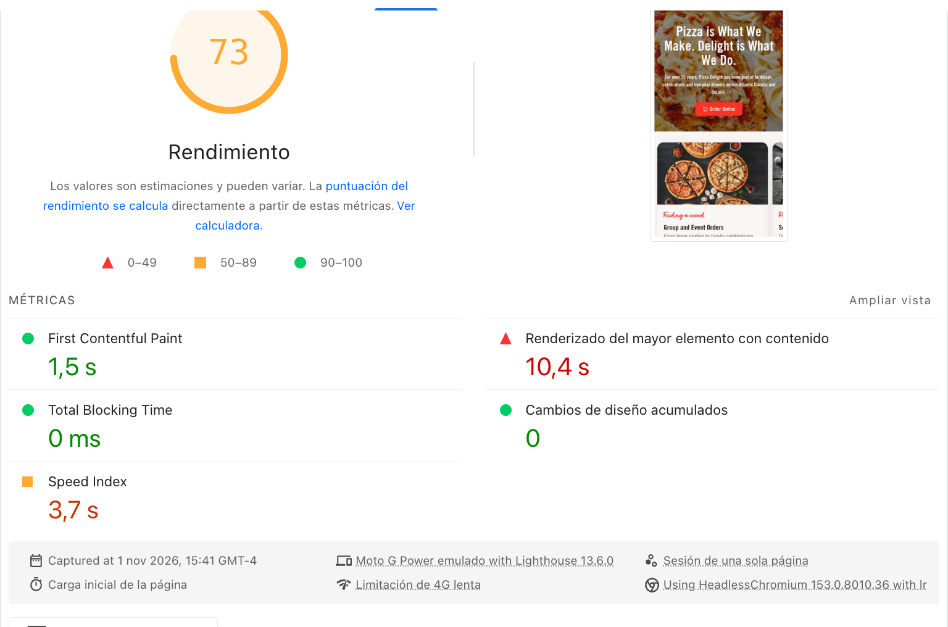

Report

# Performance scores

I tested three representative templates: the **home page**, the **offers archive** (`/offers-and-promotions/`) and a **location menu** (`/menu/antigonish/`).

## GTmetrix — home page

  <figure class="shot">
    
    <figcaption><b>Before</b> Oct 31 · Grade C · 64% · CLS 0.93</figcaption>
  </figure>
  <figure class="shot">
    
    <figcaption><b>After</b> Nov 1 · 93% performance · LCP 1.3 s · CLS 0</figcaption>
  </figure>

| Metric | Before | After |
|---|---|---|
| Grade | C | **B** |
| Performance / Structure | 64% / 91% | **93% / 84%** |
| Largest Contentful Paint | 1.5 s | **1.3 s** |
| Total Blocking Time | 11 ms | **0 ms** |
| Cumulative Layout Shift | 0.93 | **0** |
| Fully Loaded | 2.0 s | **1.3 s** |

## PageSpeed Insights

Scores are **Performance / Accessibility / Best Practices / SEO**.

| Page | Device | Before | After | CLS |
|---|---|---|---|---|
| Home | Desktop | 73 / 92 / 100 / 92 | **92** / 90 / 100 / 92 | 0.86 → **0** |
| Home | Mobile | 65 / 88 / 100 / 92 | **73** / 90 / 100 / 92 | 0.37 → **0** |
| Offers & promotions | Desktop | 76 / 89 / 100 / 92 | **100** / 89 / 100 / 92 | 0.90 → **0** |
| Offers & promotions | Mobile | 97 / 84 / 100 / 92 | **100** / 89 / 100 / 92 | **0** |
| Menu — Antigonish | Desktop | 100 / 90 / 100 / 92 | **99** / 90 / 100 / 92 | **0** |
| Menu — Antigonish | Mobile | 77 / 87 / 100 / 92 | **99** / 90 / 100 / 92 | 0.045 → **0** |

  <figure class="shot">
    
    <figcaption><b>Home · desktop</b> 92 · CLS 0 · LCP 1.8 s</figcaption>
  </figure>
  <figure class="shot">
    
    <figcaption><b>Home · mobile</b> 73 · CLS 0 · TBT 0 ms</figcaption>
  </figure>

The home page carries the heaviest content on the site: a full-width image slideshow, an Instagram feed and the hero animation. The mobile score reflects that payload under simulated slow 4G; on a real connection the hero renders fully and the page stays stable (TBT 0 ms, CLS 0).

  <figure class="shot">
    
    <figcaption><b>Home · mobile, live</b> Hero slideshow and headline rendered for a first-time visitor</figcaption>
  </figure>

## Real-user data (CrUX)

The CrUX window covers the previous 28 days, so these snapshots are the baseline the new numbers will be measured against. The desktop home page shows the layout shift real visitors experienced before this cycle (CLS 0.64), and the offers archive already passes all Core Web Vitals.

  <figure class="shot">
    
    <figcaption><b>Home · desktop</b> Baseline before the fixes</figcaption>
  </figure>
  <figure class="shot">
    
    <figcaption><b>Offers · mobile</b> Core Web Vitals passed</figcaption>
  </figure>

