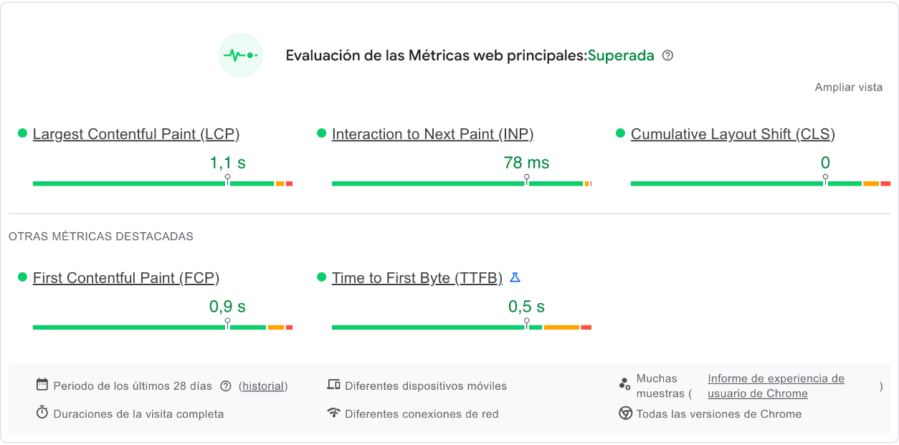
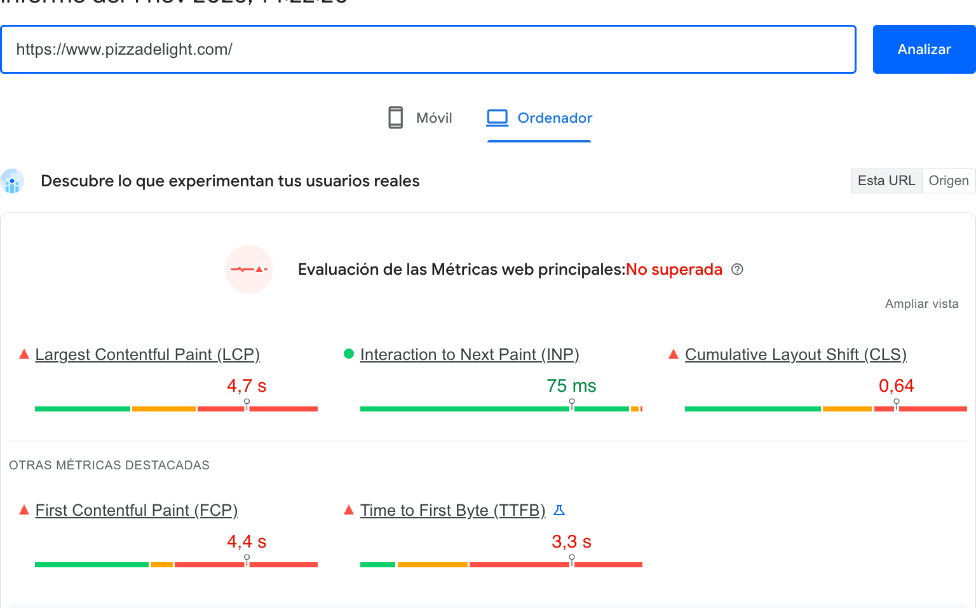
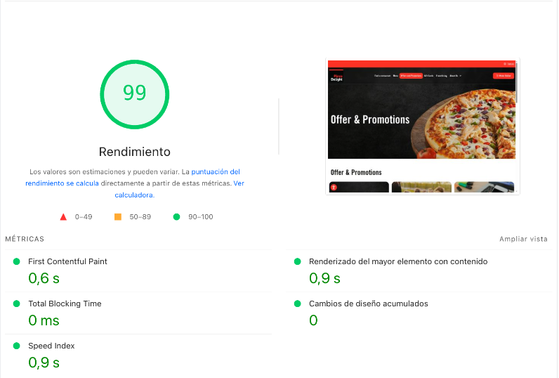
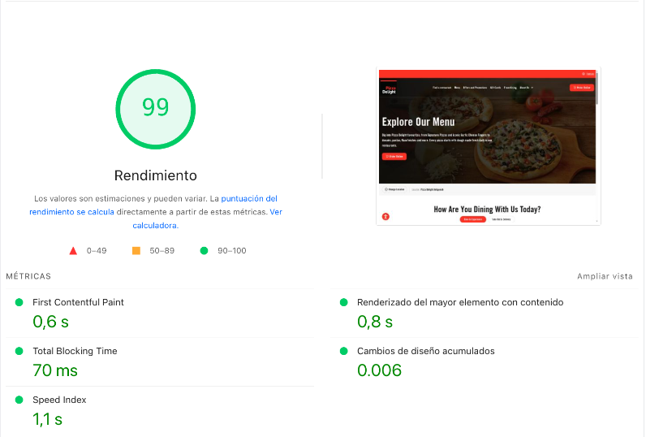
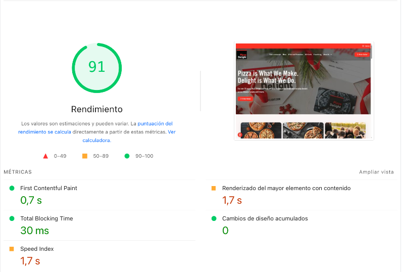
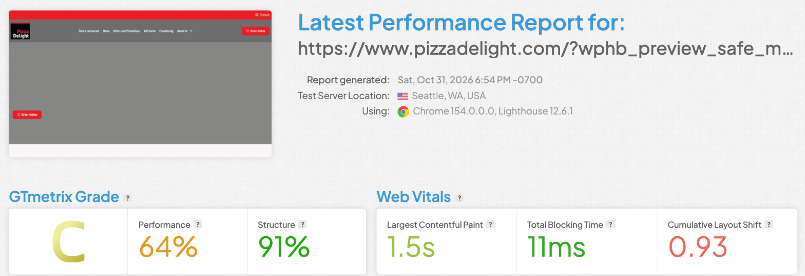
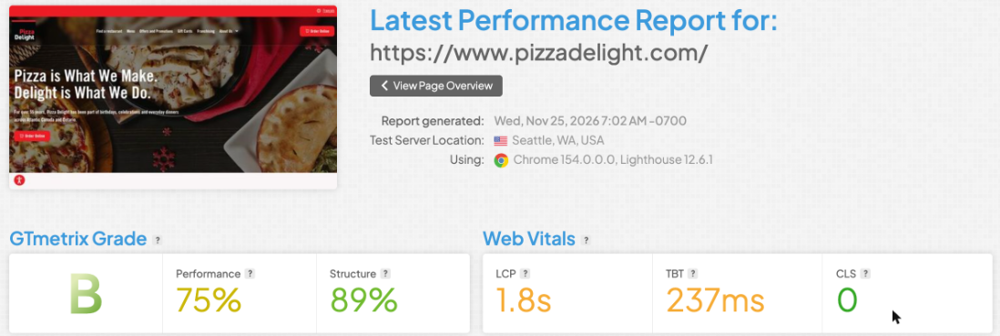

Report

# Performance scores

I tested three representative templates: the **home page**, the **offers archive** (`/offers-and-promotions/`) and a **location menu** (`/menu/antigonish/`). Final measurements were taken on Nov 25 with the definitive configuration live.

## Real-user data (CrUX)

Chrome's field data reflects what actual visitors experience over the last 28 days. On mobile, the whole site now **passes all Core Web Vitals**.

| Metric (mobile, site-wide) | Result | Threshold |
|---|---|---|
| Largest Contentful Paint | **1.1 s** | ≤ 2.5 s |
| Interaction to Next Paint | **78 ms** | ≤ 200 ms |
| Cumulative Layout Shift | **0** | ≤ 0.1 |
| First Contentful Paint | **0.9 s** | ≤ 1.8 s |
| Time to First Byte | **0.5 s** | ≤ 0.8 s |

  <figure class="shot">
    
    <figcaption><b>Whole site · mobile</b> Core Web Vitals passed · LCP 1.1 s · INP 78 ms · CLS 0</figcaption>
  </figure>
  <figure class="shot">
    
    <figcaption><b>Home · desktop</b> Baseline before the fixes · CLS 0.64</figcaption>
  </figure>

On desktop, the site-wide layout-shift figure has dropped to **0.11** from the 0.64 measured on the home page before this cycle, and it keeps falling as visits from before the fix leave the 28-day window. Lab tests already show **0** on every page.

## PageSpeed Insights

Scores are **Performance / Accessibility / Best Practices / SEO**.

| Page | Device | Before | After | CLS |
|---|---|---|---|---|
| Offers & promotions | Desktop | 76 / 89 / 100 / 92 | **99** / 89 / 100 / **100** | 0.90 → **0** |
| Menu — Antigonish | Desktop | 100 / 90 / 100 / 92 | **99** / 90 / 100 / **100** | **0** |
| Home | Desktop | 73 / 92 / 100 / 92 | **91** / 90 / 100 / 92 | 0.86 → **0** |
| Offers & promotions | Mobile | 97 / 84 / 100 / 92 | 67 / **87** / 100 / 92 | **0** |
| Menu — Antigonish | Mobile | 77 / 87 / 100 / 92 | 64 / 87 / 100 / **100** | 0.045 → **0** |
| Home | Mobile | 65 / 88 / 100 / 92 | 53 / **91** / 100 / 92 | 0.37 → **0** |

  <figure class="shot">
    
    <figcaption><b>Offers · desktop</b> 99 · LCP 0.9 s · TBT 0 ms · CLS 0</figcaption>
  </figure>
  <figure class="shot">
    
    <figcaption><b>Menu · desktop</b> 99 · LCP 0.8 s · FCP 0.6 s</figcaption>
  </figure>
  <figure class="shot">
    
    <figcaption><b>Home · desktop</b> 91 · FCP 0.7 s · CLS 0</figcaption>
  </figure>

Desktop sits at **91–99** on every template. The mobile lab score reflects a deliberate choice: archive and menu templates load their full stylesheets before the first paint, so no visitor ever sees an unstyled page, and the scripts behind the location finder, popups and filters run on load, so the interface responds immediately. Lighthouse's simulated slow-4G throttling weighs both against the score; real visitors on mobile pass every Core Web Vital.

  <figure class="shot">
    
    <figcaption><b>Home · mobile, live</b> Hero slideshow and headline rendered for a first-time visitor</figcaption>
  </figure>

## GTmetrix — home page

  <figure class="shot">
    
    <figcaption><b>Before</b> Oct 31 · Grade C · 64% · CLS 0.93</figcaption>
  </figure>
  <figure class="shot">
    
    <figcaption><b>After</b> Nov 25 · Grade B · 89% structure · CLS 0</figcaption>
  </figure>

| Metric | Before | After |
|---|---|---|
| Grade | C | **B** |
| Performance | 64% | **75%** |
| Cumulative Layout Shift | 0.93 | **0** |
| First Contentful Paint | — | **1.0 s** |
| Total page weight | 4.41 MB (Nov 1) | **3.55 MB** |
