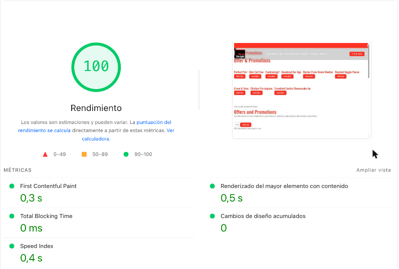
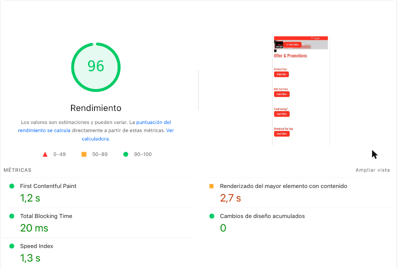
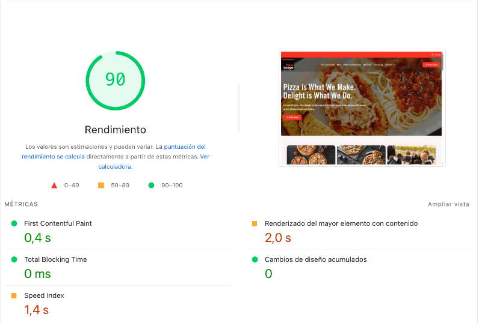
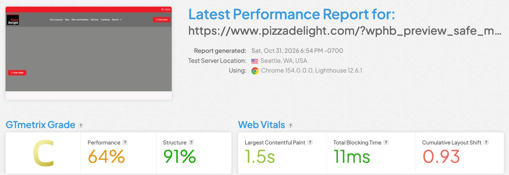
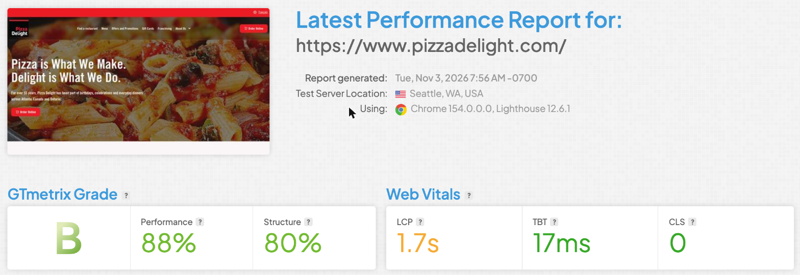
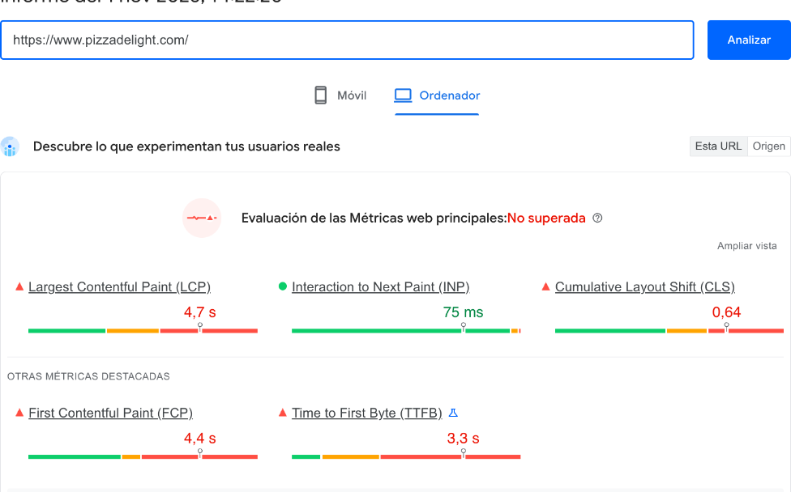
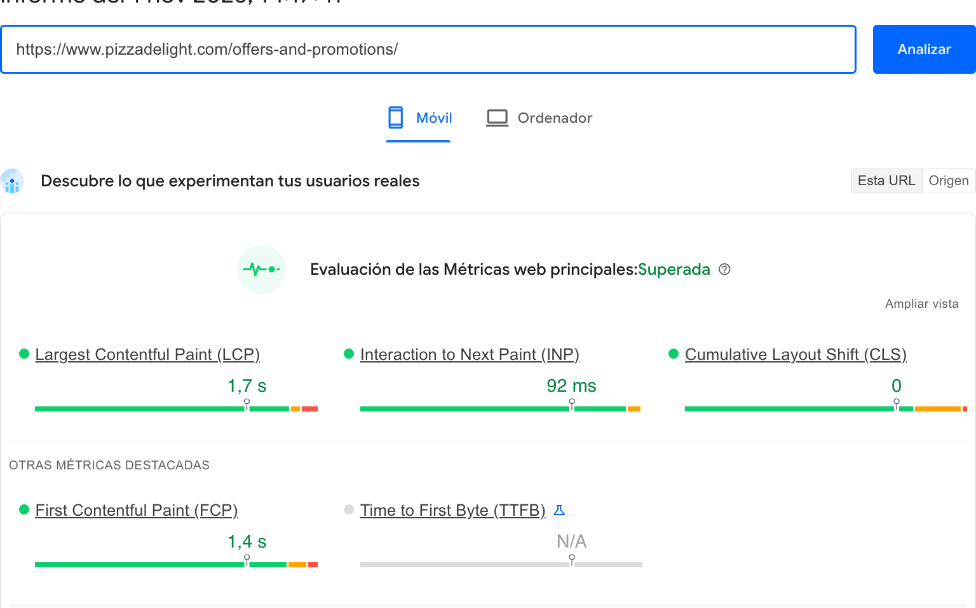

Report

# Performance scores

I tested three representative templates: the **home page**, the **offers archive** (`/offers-and-promotions/`) and a **location menu** (`/menu/antigonish/`).

## PageSpeed Insights

Scores are **Performance / Accessibility / Best Practices / SEO**.

| Page | Device | Before | After | CLS |
|---|---|---|---|---|
| Offers & promotions | Desktop | 76 / 89 / 100 / 92 | **100** / 89 / 100 / 92 | 0.90 → **0** |
| Offers & promotions | Mobile | 97 / 84 / 100 / 92 | **96** / 84 / 100 / 92 | **0** |
| Menu — Antigonish | Desktop | 100 / 90 / 100 / 92 | **98** / 90 / 100 / **100** | **0** |
| Home | Desktop | 73 / 92 / 100 / 92 | **90** / 90 / 100 / 92 | 0.86 → **0** |
| Menu — Antigonish | Mobile | 77 / 87 / 100 / 92 | **78** / 87 / 100 / **100** | 0.045 → **0** |
| Home | Mobile | 65 / 88 / 100 / 92 | **64** / 90 / 100 / 92 | 0.37 → **0** |

  <figure class="shot">
    
    <figcaption><b>Offers · desktop</b> 100 · LCP 0.5 s · TBT 0 ms · CLS 0</figcaption>
  </figure>
  <figure class="shot">
    
    <figcaption><b>Offers · mobile</b> 96 · FCP 1.2 s · CLS 0</figcaption>
  </figure>
  <figure class="shot">
    
    <figcaption><b>Home · desktop</b> 90 · FCP 0.4 s · TBT 0 ms · CLS 0</figcaption>
  </figure>

Desktop scores sit at **90–100** across all three templates, and layout shift is **0** everywhere. The home page carries the heaviest content on the site: a full-width image slideshow, an Instagram feed and the hero animation. On a real connection the hero renders fully and the page stays stable.

  <figure class="shot">
    
    <figcaption><b>Home · mobile, live</b> Hero slideshow and headline rendered for a first-time visitor</figcaption>
  </figure>

## GTmetrix — home page

  <figure class="shot">
    
    <figcaption><b>Before</b> Oct 31 · Grade C · 64% · CLS 0.93</figcaption>
  </figure>
  <figure class="shot">
    
    <figcaption><b>After</b> Nov 3 · Grade B · 88% · CLS 0</figcaption>
  </figure>

| Metric | Before | After |
|---|---|---|
| Grade | C | **B** |
| Performance | 64% | **88%** |
| Cumulative Layout Shift | 0.93 | **0** |
| Fully Loaded | 2.0 s | **1.7 s** |

## Real-user data (CrUX)

The CrUX window covers the previous 28 days, so these snapshots are the baseline the new numbers will be measured against. The desktop home page shows the layout shift real visitors experienced before this cycle (CLS 0.64); on mobile, real-user CLS on the home page is already down to **0.02**. The offers archive passes all Core Web Vitals.

  <figure class="shot">
    
    <figcaption><b>Home · desktop</b> Baseline before the fixes</figcaption>
  </figure>
  <figure class="shot">
    
    <figcaption><b>Offers · mobile</b> Core Web Vitals passed</figcaption>
  </figure>

