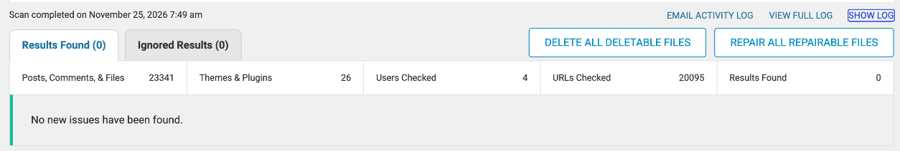

Report

# Security scan

I ran a full Wordfence scan once the final configuration was live. It flagged pending component updates, which were applied straight away. **No open issues remain.**

  
<h5>Results found</h5>
0

Scan completed Nov 25, 07:49

  
<h5>Files scanned</h5>
23,341

24 plugins · 2 themes · 44 posts

  
<h5>URLs checked</h5>
20,095

Against known-malicious lists

  
<h5>Users audited</h5>
4

Password strength and options

  <figure class="shot">
    
    <figcaption><b>Wordfence → Scan</b> Nov 25 · 0 results · 23,341 files, 26 themes and plugins, 4 users and 20,095 URLs checked.</figcaption>
  </figure>

## Firewall

During the cycle, Wordfence's firewall blocked a legitimate admin request: Smash Balloon saves its settings as a large JSON string, which matched a generic XSS rule. I allow-listed that single parameter (`model` on `admin-ajax.php`). The firewall stays fully active for every other request.
