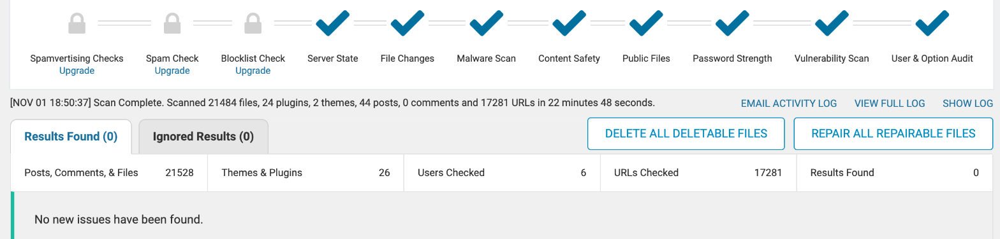

Report

# Security scan

I ran a full Wordfence scan after all the changes in this cycle were live. **No issues were found.**

  
<h5>Results found</h5>
0

Scan completed Nov 1, 18:50

  
<h5>Files scanned</h5>
21,484

24 plugins · 2 themes · 44 posts

  
<h5>URLs checked</h5>
17,281

Against known-malicious lists

  
<h5>Users audited</h5>
6

Password strength and options

  <figure class="shot">
    
    <figcaption><b>Wordfence → Scan</b> Server state, file changes, malware, content safety, public files, passwords, vulnerabilities and user audit all passed.</figcaption>
  </figure>

## Firewall

During the cycle, Wordfence's firewall blocked a legitimate admin request: Smash Balloon saves its settings as a large JSON string, which matched a generic XSS rule. I allow-listed that single parameter (`model` on `admin-ajax.php`). The firewall stays fully active for every other request.
